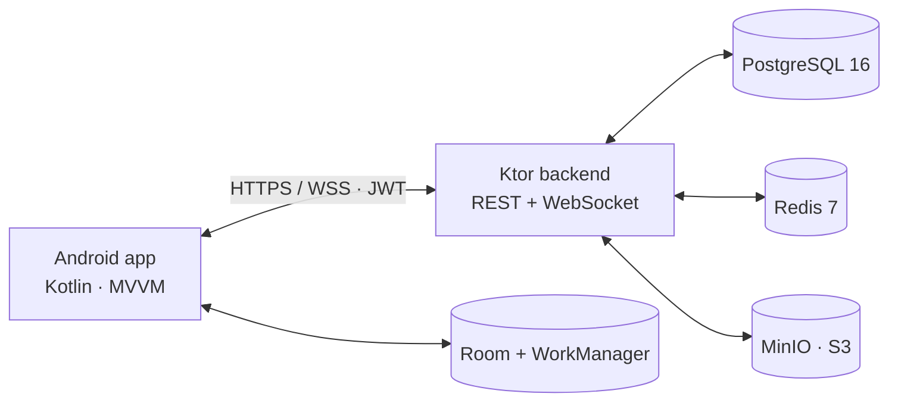

<p align="center">
  
</p>

<h1 align="center">Eilaji (علاجي)</h1>

<p align="center">Pharmacy catalog, nearby search, prescriptions, chat, orders and reminders — one self-hosted stack.</p>

<p align="center">
  <a href="https://github.com/HeshamAbuShaban/Eilaji/actions/workflows/android-ci.yml"></a>
  <a href="https://github.com/HeshamAbuShaban/Eilaji/actions/workflows/backend-ci.yml"></a>
  <a href="https://github.com/HeshamAbuShaban/Eilaji/releases/latest"></a>
  
  
  
  
</p>

## Contents

- [Features](#features)
- [Architecture](#architecture)
- [Quickstart](#quickstart)
- [Connecting a phone & offline behavior](#connecting-a-phone--offline-behavior)
- [Configuration](#configuration)
- [API](#api)
- [Demo data](#demo-data)
- [Security](#security)
- [Maintenance and upgrades](#maintenance-and-upgrades)
- [Project layout](#project-layout)
- [CI & releases](#ci--releases)
- [Roadmap](#roadmap)
- [Docs](#docs)
- [License](#license)

## Features

- **Catalog** — categories, subcategories and medicines with manufacturer, pricing, prescription flags and alternatives.
- **Nearby search** — radius-based pharmacy search, map markers with a detail pager (rating, distance, open status, call and chat actions).
- **Prescriptions** — photo upload with status lifecycle through quote, acceptance and completion.
- **Chat** — WebSocket messaging with history persistence and offline queueing.
- **Cart & orders** — cart with badge, checkout with delivery address and payment method, order tracking.
- **Reminders** — exact alarms with WorkManager fallback, daily/weekly/custom intervals, dosage support, reboot-safe, backend sync.
- **Favorites & ratings** — offline-first favorites, 1–5 star pharmacy ratings with rollup averages.
- **Guest browsing** — catalog, search and map work without an account; sign-in required for prescriptions, chat and orders.
- **Two languages** — English and Arabic UI with dark-mode support.

## Architecture



| Component | Role |
|---|---|
| `app/` | Native Android client (MVVM, ViewBinding, Navigation, Retrofit, Room) |
| `eilaji-backend/` | Ktor service: auth, catalog, pharmacies, prescriptions, orders, chat, ratings |
| Postgres | Relational data, geo-search, transactions |
| Redis | Cache and pub/sub |
| MinIO | Prescription and image storage |

## Quickstart

**Prerequisites:** JDK 17+ (backend CI uses 21), Android SDK 34, Docker & Compose.

```bash
# 1. Backend + infrastructure
cd eilaji-backend
docker-compose up -d        # postgres:5432 · redis:6379 · minio:9000/9001
./gradlew :backend:run      # http://localhost:8080

# 2. Verify
curl http://localhost:8080/health
curl "http://localhost:8080/api/v1/medicines?page=0&pageSize=2"
curl "http://localhost:8080/api/v1/pharmacies/nearby?lat=31.5&lng=34.46&radius=10"
```

```bash
# 3. App — download app-debug.apk from Releases, then:
adb reverse tcp:8080 tcp:8080   # physical device (see below)
adb install -r app-debug.apk
# Emulator debug builds already target http://10.0.2.2:8080
```

**Demo accounts (opt-in).** Seeding writes random passwords unless you ask for the known ones:

```bash
SEED_ON_STARTUP=true SEED_DEMO_CREDENTIALS=true ./gradlew :backend:run
# every seeded account now uses the password "password123"
```

Without `SEED_DEMO_CREDENTIALS`, the same accounts get a random password that is printed once
during seeding. Seeding never runs in production (`APP_PROFILE=prod` refuses it).

## Connecting a phone & offline behavior

**Why `adb reverse`?** An emulator reaches your PC via the special address `10.0.2.2`, but a physical phone has no route to your PC's `localhost`. `adb reverse tcp:8080 tcp:8080` opens a reverse tunnel so the phone's own `localhost:8080` forwards to the PC — the debug app points at `http://localhost:8080`, so it just works over USB. No Wi-Fi, no firewall rules. Re-run it each time you unplug/replug (check with `adb reverse --list`).

**If you disconnect:** the app no longer goes blank. Catalog, categories and best-sellers are cached on every successful fetch and served with an "Offline — showing saved data" notice; nearby pharmacies fall back to the last saved list; favorites, reminders and cart are local-first and sync later. Chat, search-as-you-type, checkout and live tracking need a connection and will tell you so with a retry action instead of an empty screen.

## Configuration

Defaults live in `eilaji-backend/backend/src/main/resources/application.conf`.
Every value has an environment override. Production settings live in `docker-compose.prod.yml`.

| Variable | Default | Purpose |
|---|---|---|
| `APP_PROFILE` | `dev` | `dev`/`test` create tables at boot; `prod` only applies migrations |
| `DATABASE_URL` · `DATABASE_USER` · `DATABASE_PASSWORD` | local dev values | Postgres connection |
| `REDIS_URL` | `redis://localhost:6379` | Cache, pub/sub, rate limiting (supports `redis://:password@host:port`) |
| `MINIO_ENDPOINT` · `MINIO_ACCESS_KEY` · `MINIO_SECRET_KEY` | dev values | Object storage |
| `JWT_SECRET` | *(none)* | Token signing. **Required in production, 32+ characters.** |
| `CORS_ALLOWED_HOSTS` | *(empty)* | Comma-separated browser origins allowed with credentials |
| `SEED_ON_STARTUP` · `SEED_DEMO_CREDENTIALS` | `false` | Seeding controls. Both must stay `false` in production |
| `EILAJI_PLUS_WEBHOOK_SECRET` | *(empty)* | HMAC secret that signs inbound webhooks |
| `MAX_UPLOAD_BYTES` · `MAX_WS_FRAME_BYTES` | 8 MB / 1 MB | Request limits |
| `RATE_LIMIT_LOGIN` · `RATE_LIMIT_REGISTER` | 5/min · 3/hour | Brute-force limits |
| `BCRYPT_COST` | `12` | Password hashing cost |

Full list and behaviour: [docs/SECURITY.md](docs/SECURITY.md) and [docs/UPGRADING.md](docs/UPGRADING.md).

### Android keys

`MAPS_API_KEY` is read from `local.properties` (never committed) or CI secrets.
The release network config forbids cleartext HTTP; debug builds allow it only for
`localhost` and the emulator addresses.

## API

| Method & path | Description |
|---|---|
| `GET /health` | Service status |
| `GET /api/v1/medicines?page=&pageSize=&subcategoryId=` | Paginated medicines |
| `GET /api/v1/medicines/{id}` · `GET /api/v1/medicines/search?q=` | Details · full-text search |
| `GET /api/v1/medicines/categories` | Categories with subcategories |
| `GET /api/v1/pharmacies?page=&pageSize=&city=` | Pharmacy listing |
| `GET /api/v1/pharmacies/nearby?lat=&lng=&radius=` | Radius search |
| `POST /api/v1/auth/register` · `/auth/login` · `/auth/refresh` | Auth |
| `POST /api/v1/prescriptions` (multipart) · `GET /api/v1/prescriptions` | Prescription upload & list |
| `POST /api/v1/orders` · `GET /api/v1/orders` | Orders (direct OTC supported; the server recomputes totals and reserves stock) |
| `PUT /api/v1/orders/{id}/cancel` | Cancel an order (patient: own; pharmacy/admin: their store) |
| `PUT /api/v1/prescriptions/{id}/status` | Pharmacist triage: quote, accept or reject |
| `POST /api/v1/auth/forgot-password` · `/auth/reset-password` | Password reset (code is returned until a delivery provider is configured) |
| `PUT /api/v1/orders/{id}/courier` | Live courier position (pharmacist) |
| `GET/PUT /api/v1/pharmacies/{id}/stock` | Stock list / upsert (write: own stores) |
| `GET /api/v1/chats` · `POST /api/v1/chats` · `GET /api/v1/chats/{id}/messages` | Chat REST |
| `WS /api/v1/ws/chat?token=JWT` | Chat socket |
| `GET/POST /api/v1/favorites` | Favorites |
| `POST /api/v1/ratings` · `GET /api/v1/pharmacies/{id}/ratings` | Ratings |

## Demo data

Seeding only runs when `SEED_ON_STARTUP=true` and never in production.
It writes 6 categories, 12 subcategories, 36 medicines and 30 pharmacies across 4 regions,
plus one owner account per pharmacy and 2 sample chat threads.

## Project layout

```
app/src/main/java/dev/anonymous/eilaji/
├── ui/base/.../home|categories|chatting|profile|send_prescription
├── ui/other/{map,add_address,medicine,checkout,orders,tracking,search,favorite,reminder,messaging}
├── adapters/  network/  data/repository/ (CartRepository, CatalogCache)
├── reminder_system/ (Room + WorkManager + AlarmReceiver + AlarmActivity)
└── storage/ (AppSharedPreferences)
eilaji-backend/backend/src/main/kotlin/com/eilaji/backend/
├── controller/  service/  data/  websocket/  security/  initialization/  config/
├── resources/static/dashboard/ (ops dashboard: pharmacy, stock, chats, courier sim, customer)
.github/workflows/  android-ci.yml  backend-ci.yml
docs/assets/  docs/screenshots/
```

## Security

Short version; the full rules live in [docs/SECURITY.md](docs/SECURITY.md).

- JWT access tokens carry a `sub` claim; refresh tokens use a separate audience and rotate on use.
- Logout revokes the token id in Redis, so it stops working immediately.
- Chat threads, orders and prescription reviews are checked against the caller's identity.
- A 401 triggers one automatic token refresh, then the session ends.
- Error responses never contain stack traces; the cause stays in the server log.
- Rate limiting fails closed on the auth routes when Redis is unreachable.
- Tokens, the keystore and the Google Maps key never live in the repository.

**Report a vulnerability privately.** Do not open a public issue. Use GitHub's private
vulnerability reporting, or contact the maintainer directly.

## Maintenance and upgrades

Step-by-step procedures for a backend upgrade, a schema change and a release live in
[docs/UPGRADING.md](docs/UPGRADING.md). The changelog is [CHANGELOG.md](CHANGELOG.md).

## CI & releases

- **Android CI** (JDK 17): unit tests, Android Lint, then `assembleDebug` → APK artifact on every push.
  A `v*` tag builds a release APK from the tag version and attaches it to a GitHub Release.
  Release signing uses the `RELEASE_KEYSTORE_BASE64` secret; without it CI publishes the debug artifact instead.
- **Backend CI** (JDK 21, Postgres 16 + Redis 7): `:backend:build` + `:backend:test`.
- Latest stable: [Releases](https://github.com/HeshamAbuShaban/Eilaji/releases/latest).

## Roadmap

- Pharmacist workbench app (dashboard covers testing until then)
- Stock badges on storefront (APIs ready: `GET/PUT /pharmacies/{id}/stock`)
- Real courier feed (app prefers backend position when present; simulator drives it today)
- Ranked search with filters
- Phone OTP onboarding, refill prediction, referrals

## Docs

| Document | Contents |
|---|---|
| [docs/SECURITY.md](docs/SECURITY.md) | Secret handling, threat model, rotated credentials, reporting |
| [docs/UPGRADING.md](docs/UPGRADING.md) | Backend upgrade, migrations, release runbook |
| [CHANGELOG.md](CHANGELOG.md) | Release history |
| [docs/TESTING-DASHBOARD.md](docs/TESTING-DASHBOARD.md) | Ops dashboard walkthrough |
| [eilaji-backend/README.md](eilaji-backend/README.md) | Backend architecture and API reference |

## License

Portfolio / educational use only — not licensed for commercial use or redistribution.
© Hesham AbuShaban, 2025. See [LICENSE](LICENSE).
